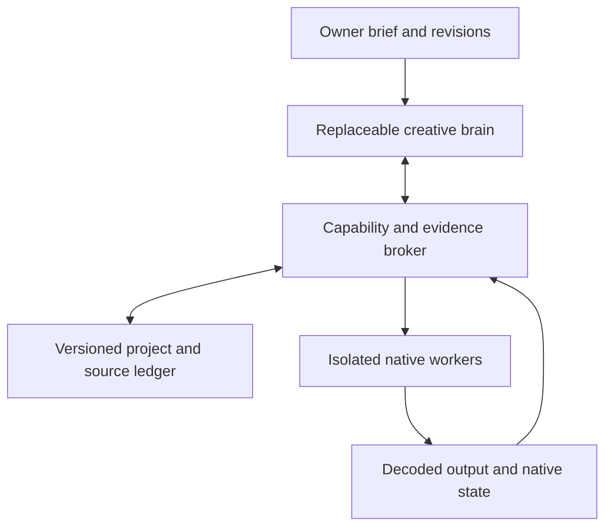

# ZX7 BODY architecture

## Status and authority

Architect's proposed design, based on source baseline
`f80a39824626bc319204e3ba89bae991a62541b1`, reviewed 29 October 2026.
The owner has delegated architectural choices and authorized repository updates.
These are engineering decisions made under that delegation, not claims that the
owner selected particular libraries. [CAPABILITIES.md](../CAPABILITIES.md)
remains the product contract. [Reuse research](reuse-research.md) distinguishes
source findings, measurements and unresolved experiments.

This design is a migration target, not a description of a completed runtime.
Targeted repair of reproduced defects is now authorized under the owner's
29 October implementation delegation. Major engine replacement and unverified
new architecture remain gated by comparative research. The executable
precision matrix and a small native renderer comparison have run; broader
renderer comparisons, isolation and model trials remain unresolved. The compact
[measurement record](../research/foundation-evidence.json) survives CI artifact
expiry. Do not change this status merely
because the document or an experiment passes a source-format check.

## Intent and boundaries

An owner provides an ordinary-language brief, references and authorized assets.
A replaceable creative brain chooses ideas, methods, instruments and revisions.
BODY provides editable instruments, actual project state, safe execution,
observation, history and delivery. Advertising is an important workload, not a
mandatory genre. Hindi/Hinglish is a required evaluation case.

The product is an independently designed, self-hostable open-source BODY.
Models, plugins and skills are replaceable attachments. No paid service or
third-party hosted AI API is a required runtime dependency; local engine/model
IPC or loopback HTTP is an internal transport. Source hosting and research tools
used during engineering are not delivered runtime dependencies. Adopted engines
need complete accessible pinned source, notices, patches and reproducible builds;
do not confuse an installed binary with a source-complete deliverable.

A planner, a video
generator and an audiovisual critic may be different models. None substitutes
for an editable production environment. Ordinary operation must not require
the owner to author a scene JSON or manually assemble the tool calls.

Do not prescribe a creative style, duration, scene structure or fixed pipeline.
Do not build new pixel, 3D, codec, shaping or inference engines where mature
components fit. Do build the missing coordination, loss accounting, permission,
revision and evidence boundaries. Do not infer professional quality from a
registered operation, installed executable or successful short export.

## Alternatives considered

| Approach | Useful property | Consequence | Decision |
|---|---|---|---|
| Replace the repository with a fresh implementation | Clean internal model | Repeats source custody, job recovery and native project work; no measured benefit justifies migration risk | Reject now |
| Fork one agent workstation as the whole product | Existing owner/editor UX and integrations | Inherits its project model, licenses, limits and migration burden; still needs exact audio, evidence and native editability tests | Benchmark, not foundation selected |
| Retain useful core and integrate native specialist engines | Preserves verified behavior and expressive scope; components can be replaced independently | Requires explicit boundary contracts and round-trip/loss tests | Selected architecture |

The third choice is not permission to accumulate engines. Add a backend only
when it passes a required workload or improves a measured tradeoff over the
strongest simpler route. Do not merge a legacy feature PR automatically because
it exists. Read its full diff and exact-head results against this design.

The initial matched native trial supports retaining MLT: the revised diagnostic
selected 12/12 intended source frames through MLT and 11/12 through the existing
FFmpeg composition adapter. This establishes one adapter defect and one useful
native route, not general MLT superiority or completion of the video field.

## System shape

Start with a local Python service and existing SQLite stores. Do not add a
distributed scheduler, vector database or mandatory cloud control plane before
a workload needs one. Rendering processes are separate from the trusted
coordinator. The owner UI addresses projects, jobs, previews and revisions;
engine setup and compiler details belong in diagnostic views.

### Brain boundary

Expose concise `discover`, `describe`, `inspect`, `propose_revision`, `submit`,
`observe`, `compare`, `cancel`, `resume` and `deliver` operations. These are
protocol responsibilities, not a second fixed artistic operation whitelist.
Keep current tool IDs compatible while adding versioned envelopes.

Discovery must distinguish dependency presence, policy eligibility, successful
conformance trial and supported workload. Probe results have engine/version,
host, time and reason fields. A cached installation probe cannot certify a
working renderer after its binary, plugins or configuration change.

An operation descriptor contains namespaced ID, schema version, engine/build
identity, parameter units and domains, read/write sets, expected artifact types,
resource estimate, permissions, cancellation/checkpoint behavior, known losses
and evidence level. Query details lazily rather than loading every schema into
every model turn. Host configuration determines authority; model text cannot
grant privileges, install plugins or declare its own result trustworthy.

The model may choose structured edits or procedural authoring. Structured edits
should use native introspection: RNA properties, node ports, timeline handles,
curve interpolation and collection methods. Programmatic authoring is allowed
only in an independently enforced worker boundary. Disabling Blender autoexec
or filtering Python names alone is not that boundary.

## Project and state model

Use a small manifest of identities and relationships, not a universal artistic
IR that attempts to encode every engine property. It references native
subprojects, timeline compositions, source assets, dependencies, proxy/final
artifacts, review evidence and deliveries. Existing film IR remains a supported
legacy document; it must not be the mandatory shape of a graphic or 3D project.

| Concept | Required identity and semantics |
|---|---|
| Asset | Byte digest, original filename as data, MIME/probe evidence, separate owner rights attestation and revocation state |
| Native subproject | Engine/type/schema, immutable byte digest, dependency manifest and engine configuration identity |
| Revision | Parent revision(s), logical project ID, immutable manifest digest, authored operations and expected parent precondition |
| Derived artifact | Input/revision digests, recipe/tool/build/config identities, output digest, clock/color/audio description |
| Evidence | Artifact digest, represented interval, transformations/downsampling, modality delivered and observer identity |
| Delivery | Exact accepted revision/artifact, target profile, verification receipt and unresolved/exported losses |

Content equality is not ownership, authorship or current rights. Keep the
rights ledger independent of byte deduplication; recheck current authorization
before render, observation, reuse and delivery. Revocation must invalidate
derived publication eligibility without deleting originals or rewriting history.

Use immutable manifests and compare-and-swap of the project head. An edit
consumes `expected_revision` and produces a new revision or a conflict; it must
never silently apply to a different parent. Undo selects an earlier revision
as a new head event; it does not erase intervening artifacts. A rejected or
failed native operation publishes no partial revision.

Stage files on the destination filesystem, validate them, fsync files and
directories as appropriate, then commit the head and publication record. A
SQLite transaction cannot atomically commit arbitrary external files: keep a
publication journal and reconcile interrupted prepared/committed records on
startup. Reuse existing publication/recovery code rather than building another
uncoordinated journal. Retain orphan candidates until reconciled; garbage
collect only unreferenced, unleased artifacts after the configured retention.

### Native authority and interchange

Native `.blend`/sealed motion bundles, MLT documents, layered image/vector
documents and model workflows remain authoritative for their expressive data.
OTIO carries editorial relationships and portable intent; it is not an effects
renderer and does not make engine-specific effects portable.

Each conversion produces a machine-readable report with feature/object path,
source/target semantics, disposition (`exact`, `approximated`, `baked`,
`unsupported`, `opaque_preserved`) and affected range. Default conversion fails
if the requested export would lose an essential feature. Baking needs an
explicit workflow choice, preserves the native parent, and labels the loss of
editability. Unknown imported data may be retained as inert bytes; preservation
does not authorize execution. Foreign native files open only in isolated workers.

### Time, coordinates, color and sound

* Store exact time as integer ticks and a positive rational rate. JSON float
  seconds are a legacy/input convenience, not an authoritative clock. Picture
  rate, sample rate, source PTS/timebase, timeline timecode origin and display
  timecode notation are distinct. Drop-frame notation does not change frame rate.
* Use half-open ranges `[start, end)`. Quantize once at a declared render
  boundary, report the policy and residual, and never add repeatedly rounded
  clip durations. Preserve VFR source PTS or create an explicitly mapped CFR
  proxy. Negative project positions and preroll are not negative source seeks.
* Audio placements/trims use sample units at an explicit bus rate. A frame at
  30000/1001 does not always contain an integral number of 48 kHz samples.
  Resample once where necessary, record delay/latency compensation and preserve
  original stream identity, channel layout and mapping. Codec priming and
  padding must not be confused with PCM timing errors.
* Describe pixel aspect, image origin, axis directions, transform order,
  physical units and conversion matrices. Do not silently treat source-space
  masks as canvas-space masks. Keep artist curve handles/interpolation native.
* Record primaries, transfer, matrix/range, bit depth, scene/display reference,
  alpha association and OCIO configuration digest. Never infer color space from
  an extension. Masks, depth and vectors are data, not color. Apply display
  transforms at explicit boundaries; prevent double transforms.
* Preserve mono, stereo and multichannel sources until an authored channel
  mapping. Keep dialogue/music/SFX stems and bus effects editable. A loudness
  measurement does not prove that speech is intelligible or music appropriate.

## Execution, resources and recovery

Reuse `ToolCatalog`, `DurableFilmGraph`, stage leases, source fingerprints and
publication receipts. Extend them by evidence, not by replacing them wholesale.
The scheduler reserves measured CPU, memory, GPU memory and disk; loads models
on demand; permits cancellation; and admits a job only when its required
resources fit or an authorized alternative is chosen. Do not label CPU offload
as a free speedup or silently lower requested quality to avoid an OOM.

An execution key includes normalized operation input, source bytes, rights
eligibility, upstream artifact identities, native project version, tool/build,
plugins/config/fonts/models and precision/device settings that affect output.
Stochastic recipes record seed and nondeterminism; do not promise bit-identical
GPU replays. Cache lookup still verifies physical output and current rights.
Use conservative dependency invalidation first. Optimize frame/region/tile
reuse only after proving equivalence to a clean render; never cache reuse by
an artist's claim that an edit is local.

Job states: queued, admitted, running, checkpointed, verifying, prepared,
published, failed, cancelled or reconciliation-required. Lease expiry requires
a fenced attempt identity so a stale worker cannot publish after reassignment.
Retries depend on trusted idempotence and side-effect reconciliation. A remote
model call of uncertain completion needs its own request identity/receipt;
do not assume exactly-once execution from a local SQLite row.

## Worker trust and extension mechanism

Treat model-authored code, imported native projects, media decoders, custom
nodes and tool output as untrusted. Coordinator secrets and unrestricted
filesystem/network access must not enter the worker. Linux deployment needs
an enforced isolation profile: separate user/user namespace where supported,
read-only engine, explicit read-only inputs, isolated writable output/temp,
network denial unless separately granted, process/CPU/memory/disk/time limits
and whole-process-tree termination. Choose and test the implementation on the
actual host; `bwrap` presence alone is not conformance. A deployment unable to
enforce the profile cannot enable arbitrary creative-code execution.

The current host failed a minimal `bwrap` launch with a denied NETLINK_ROUTE
socket. It has not passed the proposed isolation profile. Native trusted
structured operations must not be relabeled an arbitrary-code sandbox, and
dropping network isolation to obtain a green launch is not an acceptable fix.

Keep current trusted administrator-installed Python plugins explicitly trusted.
Do not relabel them sandboxed. Native library/plugin imports are executable code;
allowlist versions and hashes in worker images. Model-produced shader/code uses
the same resource boundary. Browser compositions package dependencies/fonts
locally and deny arbitrary URL fetches, navigation and host file access.
Validate output paths, archive member names/types/size ratios, MIME and decoded
content before promotion. Isolation reduces risk; it does not certify every
decoder or kernel safe.

## Perception and revision

Evidence is derived from actual outputs, with timed frames/continuous segments,
actual audio, waveforms, native state and explicit sampling limits. The broker
knows whether a model accepts image, video, audio or only text. It must not
claim continuous-motion or semantic audio review after supplying only stills
or measurements. Unobserved intervals remain unobserved.

A critic returns referenced intervals/objects, defect, proposed repair,
confidence and modality actually observed. The creative brain can disagree,
request further evidence, branch an alternative or revise selected native
state. A self-approval is not independent acceptance. Separate technical
validators, model critique, blinded human craft judgments and owner acceptance.
Retain rejected alternatives so a repair cannot destroy already accepted work.

Session checkpoints bind brief/facts, model identity/config, project revision,
pending decision, actual tool result, evidence and budget. Replacing a model is
an explicit new session/revision policy, not a reason to lose the project.
Compact historical context with references to durable facts and evidence;
avoid repeatedly appending transcripts to prompts or source documentation.

## Owner access and deployment

Local-first is the default; do not expose a public server to prove progress.
Reuse the service/mobile/client surfaces. A configured private deployment needs
authenticated HTTPS, owner/workspace authorization, short-lived scoped media
links, safe uploads, cancellation, resumable progress and backup/restore.
Prevent public caching of private assets and secrets in logs, previews or URLs.
Android acceptance requires a real device/off-LAN trial, not only desktop
responsive screenshots. Accessibility, upload reliability and clear blocked
states are part of the owner workflow.

Deploy independent optional engine/model environments with pinned versions and
licenses. The minimal service must work without Torch or all creative apps.
No paid GPU, hosted quota or external publication is assumed. Record storage,
tokens, downloads, cold start, inference, render and accepted-revision cost
separately. Pin the operating profile only after representative measurements.

## Migration and acceptance

Follow [the video plan](video-research-plan.md). Preserve old schemas and native
assets through compatibility adapters; never mutate a legacy project in place.
An importer records its input schema and emits an explicit new revision. Keep
old rendering selectable until the replacement wins its matched conformance
and practical workload gates. Removal requires a reviewed migration rationale,
reopen/undo/transfer proof and passing required exact-commit CI.

Video editing remains the first field. Its gate includes dependent source
custody, editable multitrack projects, exact clocks/audio, color, recovery,
observation and owner delivery. General generation and every other field remain
in scope, with their own later acceptance; adding a model must not be used to
hide unfinished editing.

Professional acceptance requires materially different briefs, real connected
model decisions through BODY, observed outputs, requested revisions, preserved
editability, reopen/transfer, interruption/recovery and independent assessment.
Disclose assistant-authored plans or manual intervention. No entire A–L field
is currently certified, and this design does not change that fact.
